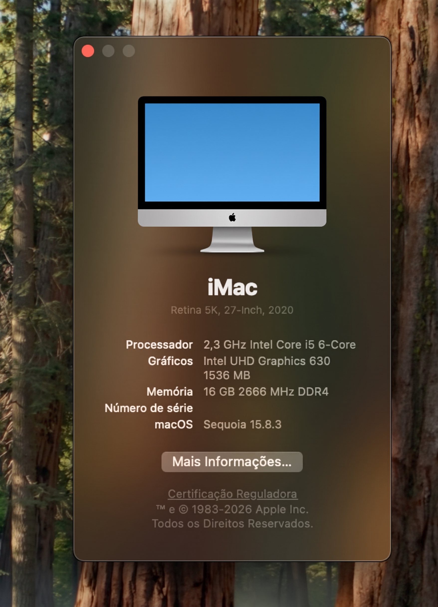

# Dell OptiPlex 3080 SFF — OpenCore macOS Sequoia

EFI configurada e testada para rodar **macOS Sequoia (15.8.3)** no **Dell OptiPlex 3080 SFF** utilizando **OpenCore 1.0.8** com interface gráfica (**OpenCanopy**).

---

## Especificações do Hardware Testado

| Componente | Especificação |
| :--- | :--- |
| **Modelo** | Dell OptiPlex 3080 SFF |
| **CPU** | Intel Core i5-10500T @ 2.30GHz (Comet Lake - 10ª Geração) |
| **GPU (iGPU)** | Intel UHD Graphics 630 (1536 MB VRAM / Metal 3) |
| **Memória RAM** | 16 GB DDR4 |
| **Armazenamento** | Samsung PM9A1 1 TB NVMe |
| **Áudio** | Realtek ALC256 (`alcid=11` + fix IRQ HPET/RTC/TIMR) |
| **Ethernet** | Realtek RTL8111 |
| **Wi-Fi / Bluetooth** | Intel Wireless (`itlwm` + `IntelBluetoothFirmware` / `BlueToolFixup`) |
| **SMBIOS** | `iMac20,1` |
| **Bootloader** | OpenCore 1.0.8 (OpenCanopy GUI) |

---

## Compatibilidade com outros Dell OptiPlex 3080

- **Processadores:** Compatível com modelos equipados com **Intel Core i3, i5 e i7 de 10ª geração** (linhas padrão e `T`, como i3-10100/10100T, i5-10500/10500T e i7-10700/10700T). **Não compatível** com processadores Intel Pentium ou Celeron (iGPU sem suporte no macOS).
- **Formatos de Gabinete (SFF / Micro / Tower):** A EFI inicializa normalmente em qualquer variação do 3080, mas o mapeamento USB (`UTBMap.kext`) foi feito para o chassi **SFF**. Em modelos **Micro** ou **Tower**, recomenda-se refazer o mapeamento das portas USB.
- **Wi-Fi / Bluetooth:** Configurado para placas Intel (`itlwm`). Máquinas sem placa Wi-Fi ou com outro chip funcionam normalmente via Ethernet (basta desativar as kexts da Intel no `config.plist` se desejar).

---

## O que funciona

- **Aceleração Gráfica:** Intel UHD 630 com 1536 MB de VRAM e suporte a **Metal 3**.
- **Áudio:** Alto-falante interno e saídas de áudio funcionando via `AppleALC` (`alcid=11`) e `SSDT-HPET_RTC_TIMR-FIX.aml`.
- **Gerenciamento de Energia CPU (XCPM):** `X86PlatformPlugin` ativo nativamente.
- **Rede:** Ethernet Gigabit (`RealtekRTL8111`), Wi-Fi Intel (`itlwm` + HeliPort) e Bluetooth.
- **Portas USB:** Mapeadas com `USBToolBox`.
- **NVMe:** Velocidade total (~2.400 MB/s de escrita sequencial) com `NVMeFix`.
- **Segurança:** SIP ativado (`enabled`).

### Ressalva sobre Sleep Mode (Repouso)
Em desktops Dell OptiPlex (especialmente combinados com o SSD **Samsung PM9A1**), o estado de repouso S3 pode causar reinicialização ao acordar devido ao comportamento do firmware da BIOS/NVMe.
Recomenda-se manter apenas o repouso do monitor ativo e desativar o repouso do sistema:

    sudo pmset -a sleep 0 disksleep 0 displaysleep 10

---

## Configurações Recomendadas na BIOS (F2)

- **Secure Boot:** `Disabled`
- **SATA Operation:** `AHCI`
- **Fastboot:** `Thorough` (ou `Minimal`)
- **VT for Direct I/O (VT-d):** `Disabled` (ou `DisableIoMapper` ativado)
- **Power Management → Deep Sleep Control:** `Disabled`
- **Power Management → USB Wake Support:** `Disabled`
- **Power Management → Wake on LAN:** `Disabled`
- **Power Management → AC Recovery:** `Power Off`

---

## Antes de usar (Obrigatório)

Os identificadores pessoais desta EFI foram removidos por segurança. Antes de dar boot:

1. Baixe o **[GenSMBIOS](https://github.com/corpnewt/GenSMBIOS)**.
2. Gere novos valores para o SMBIOS **`iMac20,1`**.
3. Preencha os campos abaixo em `EFI/OC/config.plist` → `PlatformInfo` → `Generic`:
   - `MLB`
   - `SystemSerialNumber`
   - `SystemUUID`
   - `ROM` (endereço MAC da sua placa de rede em formato Data/Hex)

---

## Créditos

- [Acidanthera](https://github.com/acidanthera) (OpenCore, Lilu, WhateverGreen, AppleALC, VirtualSMC, NVMeFix)
- [OpenIntelWireless](https://github.com/OpenIntelWireless) (`itlwm`, `IntelBluetoothFirmware`)
- [Dortania OpenCore Install Guide](https://dortania.github.io/OpenCore-Install-Guide/)
